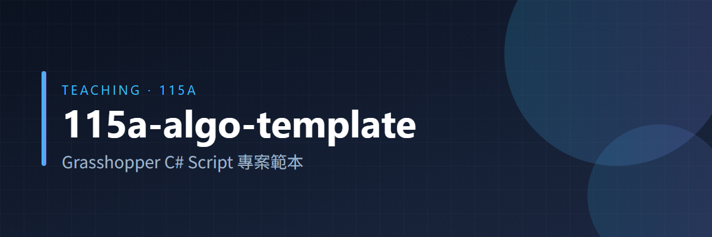

# teach-115a-algo-template

<!-- hero -->

國立陽明交通大學 115-1「演算法設計」課程的專案範本：在 `src/` 寫演算法類別，用 Grasshopper C# Script 元件載入執行。

## 狀態

active

## 快速開始

1. 在 `src/` 撰寫演算法類別（`.cs`）。
2. 在 Rhino 8 的 Grasshopper 放一個 C# Script 元件。
3. 把 `gh_script/` 內的檔案內容貼進元件（以 `#load` 讀取 `src/`）。
4. `#load` 的路徑行為見 [`docs/loading.md`](docs/loading.md)（尚待實測）。

## 目錄

| 路徑 | 內容 |
| --- | --- |
| `src/` | 所有 `.cs` 程式碼（目前有範例 `Greeter.cs`） |
| `gh_script/` | 貼進 GH Script 元件的檔案（`main.cs`） |
| `docs/` | 討論文件：`loading.md`（`#load` 實測）、`需求.md`（課程目標與待討論事項） |

開發者備註（`.claude/`、`CLAUDE.md` 等）見 [`docs/DEV.md`](docs/DEV.md)。

## 相關 repo

- [teach-115a-boids-game](https://github.com/scott-lbx/teach-115a-boids-game)：同樣用 `#load` 的多人 Boids 競技場
- [teach-algo-gallery](https://github.com/scott-lbx/teach-algo-gallery)：GH 演算法圖鑑網頁
- [ws-df26-w18](https://github.com/scott-lbx/ws-df26-w18)：DigitalFUTURES 2026 Workshop 18 教材

## 授權

未指定
